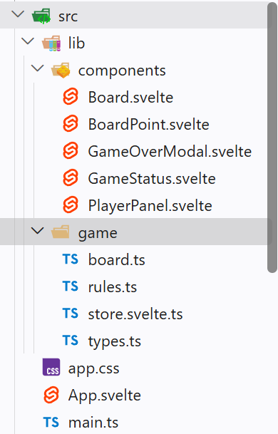

# seiwald-mitschrift

Das ist die README.md-Datei. MD steht für Markdown. Markdown ist eine heutzutage weitverbreitete Auszeichnungssprache. (_Markup Language_, [Wikipedia](https://de.wikipedia.org/wiki/Auszeichnungssprache)).

Weitere bekannte Auszeichnungssprachen sind

- Hypertext Markup Language (HTML)
- Extensible Markup Language (XML)
- Yet Another Markup Language (YAML, YML)

## Installation von Node.js

Javascript läuft unter normalen Umständen in einer Browser-Sandbox (nur im Browser). Seit ca. 2010 gibt es eine Laufzeitumgebung (_Runtime Environment_) für JS, damit man auch serverseitig JS programmieren und ausführen kann: [Node.js](https://nodejs.org/).

LTS-Version (_Long Term Support_) installieren.

## Installation von pnpm

Der standardmäßige _Pakage Manager_ für Node.js ist npm (_node package manager_). Eine etwas modernere und inzwischen beliebtere Variante ist [pnpm](https://pnpm.io/) (performant npm).  
_Package Manager_ ermöglichen die Installation von Softwarepaketen.

## Installation von Strapi

Installation mit dem Skript `npm create strapi`. Daraufhin führt uns das CLI (_Command Line Interface_) durch die Installation. Falls bei der Installation sogenannte `build scripts` nicht ausgeführt werden können, schlägt die CLI die Fehlerbehandlung selbstständig vor:

1. Wechsel in das Installationsverzeichnis (z.B. mit `cd my-strapi-project`).
2. Neuerlicher Versuch der Installation mit `pnpm install`. Dieser scheitert in der Regel - die Build-Skripte können müssen mit `pnpm approve-builds` freigegeben werden.

### Typescript

Typescript ist eine statisch typisierte Version von Javascript. In JS gibt es keine Typen, in TS schon. Jeder JS-Code ist auch ein gültiger TS-Code. Bsp.:

- JS: let x=3;
- Java: double y=4.2;
- TS: let z: number = 5;

## Datenbanken

Crawfoot Notation (--<- und mehr): Dient der Visualisierung von Beziehungen von Tabellen. Bild auf Teams.

## VibeCoding / AgenticEngineering mit VS-Code und Github Copilot

VibeCoding passiert in VS-Code in erster Linie über die neu eingeführte Agent View. Dort können alle Anpassungen des "_Coding Harness_" vorgenommen werden. Wir können unseren _Harness_ mit verschiedenen Methoden anpassen:

- **MCP-Server**  
  MCP steht für _Model Context Protocoll_. Es ist ein Standard, der von Anthropic entwickelt wurde. Mithilfe von MCP können Chatbots/LLMs (_Large Language Models_) auf zusätzliche Tools zugreifen, die sie zu Experten in einem bestimmten Themenbereich machen.

  ## Javascript-Frontendentwicklung mit Frameworks (Svelte, React, Vue, Angular, ...)

  Frontend-Entwicklung

## Grundkenntnisse

Die Path-Umgebungsvariable ist eine Liste von Verzeichnissen in Ihrem Betriebssystem. Sie teilt dem System mit, wo nach ausführbaren Programmen oder Befehlen gesucht werden soll, ohne dass Sie den vollständigen Dateipfad eingeben müssen.

CRUD:

- Create - POST
- Read - GET
- Update - PUT (überschreiben) / PATCH (ergänzen)
- Delete - DELETE

_Superset_: Übermenge  
cd: _change directory_ (Wechseln des Verzeichnisses)  
JDK: _Java Development Kit_ (Java-Entwicklungsumgebung)  
SDK: _Software Development Kit_ (Software-Entwicklungsumgebung)
_System Installer_ (Systeminstallationsprogramm): Es wird für alle Benutzer des Systems installiert.  
_User Installer_ (Benutzerinstallationsprogramm): Es wird nur für einen Benutzer installiert. Andere Benutzer haben keinen Zugriff darauf. _System Installer_(Systeminstallationsprogramm):

---

# 4BHK SWP

## Aufbau einer Website: (DOM/html-Document Object Model-Tree)

### - html = Wurzel (Root)

#### --> head:

- title
- links (css)
- OS (SEO)

#### --> body (document.body)

- ...

## Frontend Frameworks

Sie nehmen die Liste heraus und packen html, css und js in eine Datei. Es gibt verschiedene UI-Komponenten. Komponenten sind vollkommen eigenständig.

- list = ["Brot", "Kaffee", "Bier"]  
  JS --> Daten + Funktionen
- Template (Vorlage) --> html

```html
<ul>
  {for item inList}
  <li>{item}</li>
  {endfor}
</ul>
```

### Svelte

- Komponentenbasiert (single File)
- Komponenten haben Module (script, style, markup)
- deklerativ:

Metaframeworks:

- Next (React)
- Nuxt (Vue)
- SvelteKit (Svelte)

**_Unterschied Zuweisung und Mutation_**

- **Zuweisung**: Das Zuweisen eines neuen Wertes zu einer Variablen. Beispiel in JavaScript:

  ```javascript
  let x = 5; // Zuweisung
  x = 10; // Neue Zuweisung
  ```

  ```html
  Parent:svelte
  <script>
    import Child from "./Child.svelte";
  </script>

  <ul>
    <Child prop="xyz"> </Child>
  </ul>
  ```

  Geschwungene Klammern `{}` werden in Svelte verwendet, um JavaScript-Ausdrücke innerhalb des HTML-Markups einzubetten.

- **Mutation**: Das Ändern des Inhalts eines bestehenden Objekts oder Arrays, ohne die Referenz zu ändern. Beispiel in JavaScript:

- **Wichtige Runen in JavaScript:**

- $state()
- $derived()
- $effect() "Konstruktor für ein "svelte-File" => SFC

  ```javascript
  let arr = [1, 2, 3];
  arr.push(4); // Mutation des Arrays
  ```

  **Select Bindings:**

```javascript
  <script>
	let questions = [
		{
			id: 1,
			text: `Where did you go to school?`
		},
		{
			id: 2,
			text: `What is your mother's name?`
		},
		{
			id: 3,
			text: `What is another personal fact that an attacker could easily find with Google?`
		}
	];

	let selected = $state();

	let answer = $state('');

	function handleSubmit(e) {
		e.preventDefault();

		alert(
			`answered question ${selected.id} (${selected.text}) with "${answer}"`
		);
	}
</script>

<h2>Insecurity questions</h2>

<p>{selected?selected.text : "nix"}</p>
<p>
	selected question {selected
		? selected.id
		: '[waiting...]'}
</p>
```

## Github

- node.modules nie auf Github hochladen.
- .env auch nie auf Github hochladen.
- In der package.json steht, welche Abhängigkeiten das Projekt benötigt. Diese sollten nicht manuell verändert werden, sondern über den Paketmanager (z.B. npm oder yarn) installiert werden.
- _Dependencies_: Sind für das Projekt während der Laufzeit notwendig.
- _Dev Dependencies_: Braucht man nur während der Entwicklung.

## Grundkenntnisse

- _Cross-Site Scripting (XSS):_ Eine Sicherheitslücke, bei der Angreifer schädlichen Code in Webseiten einschleusen können.
- Bedingte Verzweigungen (_Conditionals_) in Svelte werden mit `{#if ...}{/if}` umgesetzt. Beispiel:
- Aria (_Accessible Rich Internet Applications_): Dienen der Barrierefreiheit und helfen dabei, Webinhalte für Menschen mit Behinderungen zugänglich zu machen.
- _Stack:_
  1. Ein Datenstrukturprinzip, bei dem das zuletzt hinzugefügte Element zuerst entfernt wird (_Last In, First Out_ - LIFO).
  2. Ein Server Stack ist ein Zusammenschluss von unterschiedlichen Programmen, die zusammenspielen damit sie einen neuen Service anbieten können (z.B.: OS, Web-Server, Datenbank, Serverseitiges Script, Mail-Server oder Frontend, API, Backend)
  3. Bereich im RAM (Speicher) einer Anwendung
- _Queue (First In, First Out - FIFO):_ Ein Datenstrukturprinzip, bei dem das zuerst hinzugefügte Element zuerst entfernt wird.
- anonyme Funktion: Eine Funktion ohne Namen, die oft als Argument an andere Funktionen übergeben wird.
- Interpreted vs. Compiled: Interpreted languages (Skriptsprachen) are executed line by line by an interpreter (e.g., Python, JavaScript), whereas compiled languages are transformed into machine code by a compiler before execution (e.g., C, C++).
- Datenkapselung (_Encapsulation_) ist ein Grundprinzip der objektorientierten Programmierung (OOP), das Daten (Attribute) und die Methoden, die auf ihnen arbeiten, in einer einzigen Einheit (Klasse) zusammenfasst und den direkten Zugriff von außen einschränkt.
- Rest-API: hat die vier CRUD-Operationen, welche einer HTTP-Methode entsprechen.
- package.json: wichtigste Datei, enthält ausführbare Befehle
- vite: Bildtool
- mount: einbinden

---

# Historische Entwicklung von WebDev

Webdevelopment hat im Laufe der letzten rund 35 Jahre einige Evolutionsstufen durchlaufen:

1. Statische Websites (HTML, CSS, ggf. JavaScript-Dateien) - initiale Phase des Webdevelopments, bei der Inhalte fest im HTML-Code verankert sind. Dominant in den 1990er-Jahren.

2. Dynamische Websites (mit serverseitiger Programmiersprache - PHP, Python, NodeJS - und **Datenbankanbindung**). Dominant in den 2000er-Jahren.

3. _Single-Page Applications_ (SPAs) - mit JavaScript-Frameworks (z.B.: React, Vue, Angular, Svelte, ...) erstellte "Webapps", die ähnliche Funktionen wie klassische Desktop-Anwendungen bzw. Handy-Apps bieten (Push-Benachrichtigungen, Kamera, GPS, Mikrofon, Bluetooth, Gyroskop/Trägheitssensor). Dominant in den 2010er-Jahren. Um Handy-Apps möglichst nahe zu kommen, wurde der _Progressive Web App_ (PWA)-Standard entwickelt. Damit können Webapps offline funktionieren, Push-Benachrichtigungen senden und auf bestimmte native Funktionen des Geräts zugreifen.  
   https://progressier.com/pwa-vs-native-app-comparison-table  
   Es gibt drei Vorraussetzungen, die eine Webapp erfüllen muss, um als PWA zu gelten:
   1. Die Webapp muss über ein Web-App-Manifest verfügen (`manifest.json`), das grundlegende Informationen (Metadaten, ...) über die App enthält (Name, Icons, Start-URL, etc.).
   2. Die Webapp muss einen Service Worker implementieren, der das Caching von Ressourcen und die Offline-Funktionalität ermöglicht. Ein Service Worker ist eine JavaScript-Datei, die im Hintergrund des Browsers läuft - selbst wenn der Browser geschlossen ist.
   3. Die Webapp muss über HTTPS bereitgestellt werden, um die Sicherheit und Integrität der Anwendung zu gewährleisten.

   Frontend-Frameworks wenden folgende Architekturprinzipien an, um eine möglichst gute _User Experience_ (UX) zu erreichen:
   - _Component-based Architecture_: **Komponenten** sind die wiederverwendbaren Klemmbausteine einer Webapp. Sie kapseln HTML, CSS und JavaScript in einer einzigen Einheit unabhängig von anderen Komponenten entwickelt, getestet und gewartet werden kann.
   - **Deklarative Programmierung**: der JavaScript und Template (HTML)-Code beschreiben, wie die Benutzeroberfläche aussehen soll, anstatt die einzelnen Schritte zur Erstellung der Benutzeroberfläche zu definieren. Das Framework kümmert sich um die Umsetzung. Dabei kommt **Reaktivität** (_reactivity_) ins Spiel: Wenn sich die Benutzeroberfläche (UI), um den neuen Zustand (_state_) widerzuspiegeln. Wenn die Aktualisierung auch in die andere Richtung funktioniert (d.h. wenn sich die Benutzeroberfläche ändert, weil der Benutzer mit ihr interagiert, und der Zustand der Anwendung entsprechend aktualisiert wird), spricht man von bidirektionaler Datenanbindung (_two-way data binding_).  
     **Logikbausteine** (Schleifen zur Darstellung von Listen und Bedingungen für das konditionale Ein- und Ausblenden von UI-Elementen) werden in den Templates der Komponenten definiert. Die Templates werden vom Framework in die eigentliche Benutzeroberfläche übersetzt. Komponenten können auch andere Komponenten enthalten (verschachtelt werden), wodurch eine hierarchische Struktur entsteht. Die Kommunikation zwischen Komponenten erfolgt über **Props** (Eigenschaften) und **Events** (Ereignisse). Props sind Daten, die von einer übergeordneten Komponente an eine untergeordnete Komponente weitergegeben werden. Events sind Benachrichtigungen, die von einer untergeordneten Komponente an eine übergeordnete Komponente gesendet werden, um auf Benutzerinteraktionen oder andere Ereignisse zu reagieren.

---

# Frontendentwicklung

## Ordnerstruktur

Die Ordnerstruktur einer typischen Frontend-Anwendung sieht in etwa so aus:  


- Der Ordner `.vscode` enthält Einstellungen für den VS-Code-Editor.
- Der Ordner `node_modules` enthält die Abhängigkeiten (_dependencies_) der Anwendung. Das sind jene Pakete, die bei der Entwicklung (_buildtime_) und/oder bei der Ausführung (_runtime_) der Anwendung benötigt werden.
- Alle Abhängigkeiten sind in der Datei `package.json` Informationen über die Anwendung selbst (Name, Version, Autor, Lizenz, etc.) und Skripte, die bestimmte Aufgaben automatisieren (z.B. Starten der Anwendung, Testen der Anwendung, Erstellen einer Produktionsversion der Anwendung).
- Der Ordner `public`/`static` enthält statische Dateien/Assets (Bilder, Videos, Schriftarten), die direkt vom Browser unter dem jeweiligen Pfad geladen werden können (public/image.png = www.johak.at/image.png)  
  
- Der Ordner `src` enthält den Quellcode der Anwendung. Die Dateien `app.css`, `App.svelte` und `main.ts` sind die Einstiegspunkte der Anwendung (in diesem Fall eine SPA). Sie werden vom Browser als erstes geladen, wenn die entsprechende Website aufgerufen wird.
  - Die Datei `app.css` enthält die globalen CSS-Stile der Anwendung.
  - Die Datei `App.svelte` ist die Hauptkomponente der Anwendung, die andere Komponenten importiert und in der Benutzeroberfläche anzeigt.
  - Die Datei `main.ts` ist der Einstiegspunkt für das JavaScript/TypeScript der Anwendung. Sie initialisiert die Anwendung in der `App.svelte` und bindet sie an das HTML-Dokument (`index.html` im Root-Ordner).
- Der Ordner `lib` enthält benutzerdefinierte Bibliotheken/UI-Komponenten und Hilfsfunktionen, die in der Anwendung verwendet werden.
  - Der Ordner `components` enthält die wiederverwendbaren Komponenten der Anwendung. Sie sind die Bausteine der Benutzerfläche.
  - Der Ordner `game` enthält die Logik für das Spiel.
  - Die Datei `store.svelte.ts` enthält den Zustand (_state_) der Anwendung. D.h. sie speichert alle Daten, die sich im Laufe der Zeit ändern können (z.B. Spielstand, Spielergebnisse, Einstellungen, usw.) und fungiert als zentrale Datenquelle - _Single Source of Truth_ (für mehr Details zum Speichermanagement im Frontend siehe Road-to-IT-Matura Team im Kanal "SWP - 06 - Softwarearchitektur").
- Alle Dateien/Ordner die in der `.gitignore` stehen werden nicht auf Github hochgeladen.

---

# 4BHK IMCM

Kontrollstrukturen

- Schleifen
- Bedingte Verzweigungen

Datenstrukturen

- Arrays
- Objekte (JS) --> key-value-Paare
